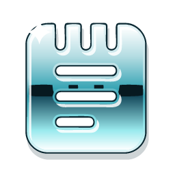

<p align="center">
  
</p>

# Facthory Page

An open-source word processor for macOS, Windows and Linux that opens and saves `.docx`
documents, from [Facthory](https://facthory.com). Styles, tables, track changes, references, mail
merge, and `.docx`, PDF, ODT, RTF, HTML and Markdown files; every command is also available to
scripts and AI agents through a command-line tool and an MCP server.

Facthory Page is based on [WordCraft](https://github.com/storytold/wordcraft) by the ArtCraft
team, and follows it closely: this repository carries WordCraft's history, merges every WordCraft
release, and offers fixes back. Facthory's changes are a small set of brand files in
[`facthory/`](../facthory/README.md), applied when the app is built.

Downloads arrive with the first release. Until then, build it from source.

## Build

```sh
python3 facthory/rebrand.py apply   # on a fresh checkout: the Facthory brand
cargo build --release -p facthorypage -p facthorypage-cli
```

`facthory/rebrand.py apply` rewrites the checkout in place (names, app ids, icons, links,
installer identities); run it on a clean clone, not on a tree you commit from. Without it you
build WordCraft as upstream ships it. The Linux build needs the packages listed in
[`.github/workflows/facthory.yml`](workflows/facthory.yml).

## Report a problem

[Open an issue](https://github.com/FACTHORYAI/page/issues). Problems that also occur in
WordCraft are reported there too, so the fix reaches both.

## Licence

MIT OR Apache-2.0, as upstream: [`LICENSE-MIT`](../LICENSE-MIT), [`LICENSE-APACHE`](../LICENSE-APACHE),
[`NOTICE`](../NOTICE) and [`ATTRIBUTION.md`](../ATTRIBUTION.md). Copyright © Bandpey GmbH for the
Facthory changes; WordCraft is copyright © the ArtCraft Team and the WordCraft contributors.
"ArtCraft" and its logos are trademarks of the ArtCraft Team; Facthory Page is not an ArtCraft
product and is not endorsed by the ArtCraft Team.
